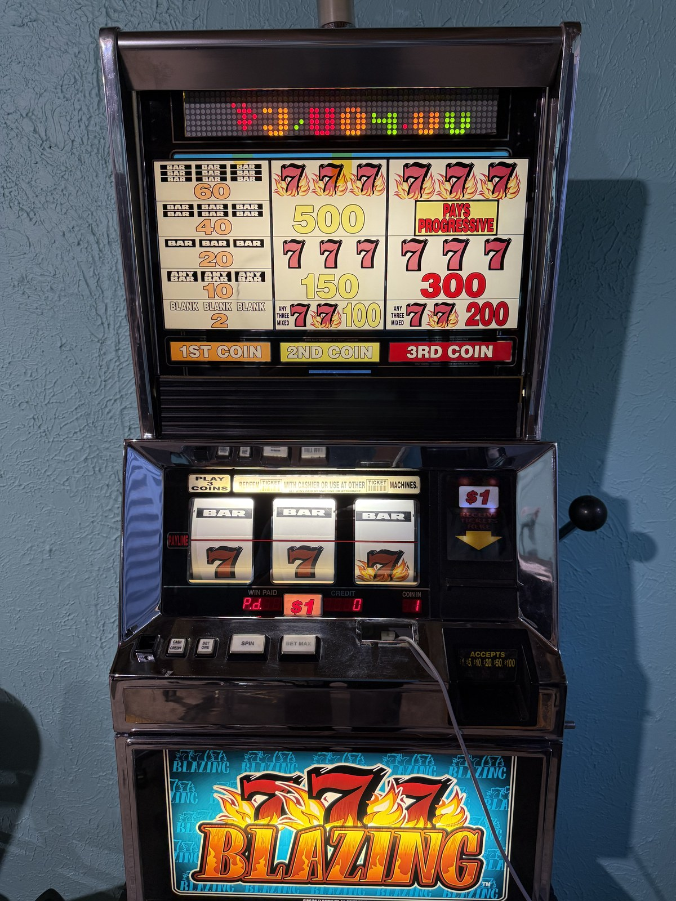
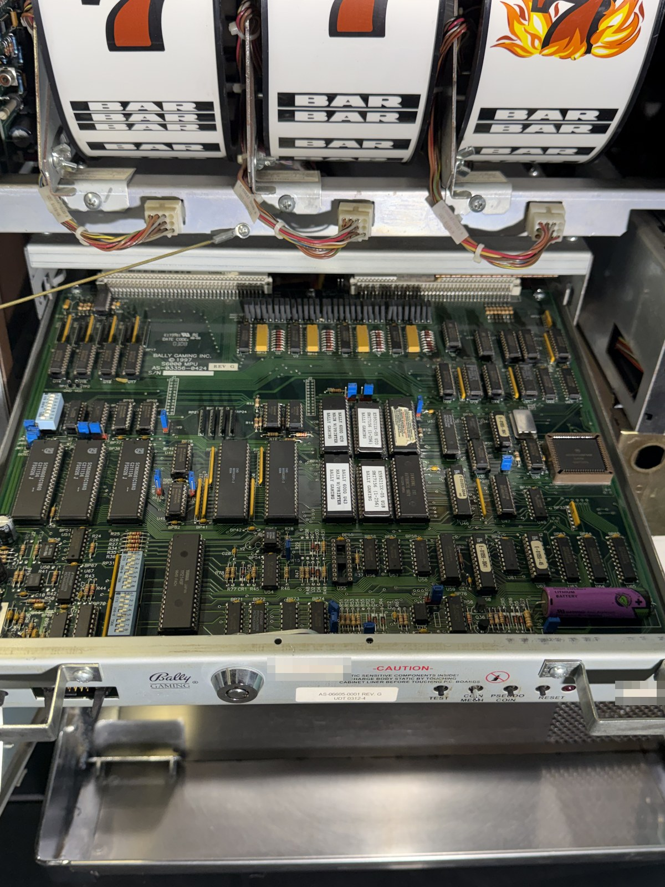
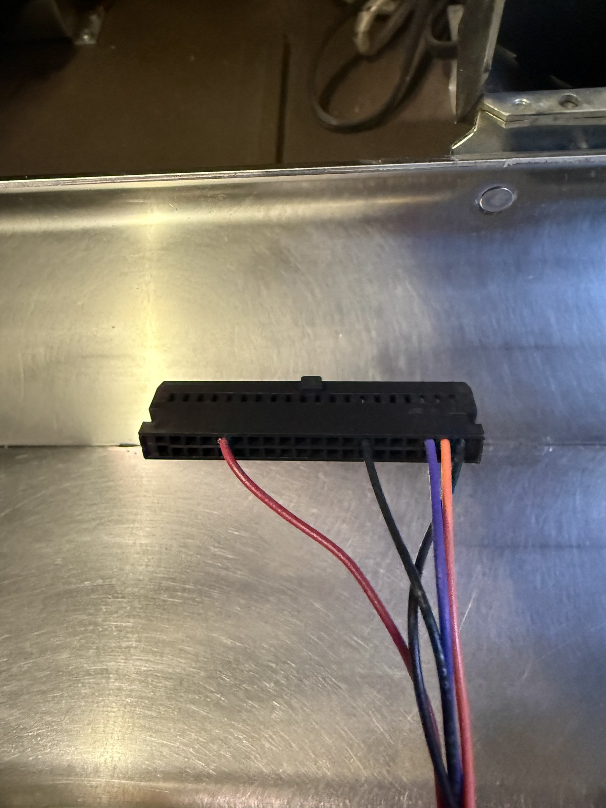

# Blazing 7s

Anyone that has seen *Ocean's 11* has always wanted to play with a Vegas slot machine.
Well... boredom and AI have finally made this possible.

The machine is a Bally ProSlot 6000 "Blazing 7s": three reels, one payline, $1 a pull,
once built for a casino floor and now privately owned. Nobody hands you the internals
of one of these, so this repository is what it took to understand it:

- **Reading the chips.** The EPROMs came off the MPU board and were dumped and merged
  into the 68000 main program and the game's personality ROM. A Ghidra project names
  the functions the notes and code cite.
- **Finding a way in.** Backplane connector J10 turned out to be the SAS port, the
  serial protocol casinos use to talk to their machines. A Linux PC with a USB RS-232
  adapter now speaks it: all 118 long polls the firmware accepts, read its meters, set
  its clock, and move credits in and out. The J3 "HHU" port and the reel control were
  traced too.
- **Teaching it new tricks.** An experimental firmware extension adds a private SAS
  command for remote game profiles (paylines, bet limits, payouts and reel stop
  weights), a chosen outcome for the next spin, and remote spins. It is built with a
  modern GCC for the 68000 and tested by running the compiled code, and the original
  ROM routines around it, in a CPU emulator. Sent over SAS, it has spun the real
  reels.

<p>
  
  
  
</p>

More photos: [the door open](photos/02-door-open.jpg),
[the backplane](photos/03-interface-board.jpg),
[the program and personality EPROMs](photos/05-mpu-eproms.jpg) and
[the DB9 breakout](photos/07-db9-breakout.jpg).

The payout and outcome features are for a privately owned machine used for
entertainment, not for use on regulated or commercial gaming machines.

`docs/` and `roms/` are third-party works owned by their publishers (Bally, IGT,
Mikohn, JCM and the others named in `docs/README.md`), included for reference and not
covered by this repository's license; the Ghidra database contains disassembly of
vendor code. The author's own code and notes are MIT-licensed: see [LICENSE](LICENSE).

To run the tests, build the firmware or connect to your own machine, see
[GETTING-STARTED.md](GETTING-STARTED.md).

## Index

- `GETTING-STARTED.md` setup: the dev container or a native install, the test and
  build commands, connecting to a machine, and the privacy check for contributors.
- `LICENSE` MIT, for the author's own work.
- `notes/machine.md` what the machine is: boards, chips, peripherals, as observed on
  the machine.
- `notes/sas-j10.md` the SAS port on backplane J10: wiring, voltage and cable checks,
  SAS host setup, commands, what the machine reported, host timing it needs, the ROM
  signature check, and which SAS long polls the firmware accepts.
- `notes/j3-hhu-protocol.md` what is known about the J3 (HHU) serial link.
- `notes/reel-control.md` internal reel-motion and normal-outcome hooks and
  stop/symbol mapping. No stock serial reel-target command has been established.
- `firmware/README.md` experimental chip images, CLI usage, offline verification
  and installation blockers. `firmware/INTEGRATION.md` defines native hook contracts,
  persistence and recovery; `firmware/toolchain.md` documents builds and CPU tests.
  Limited live bring-up is recorded in `notes/firmware-bringup.md`: two stock
  spins, idle-restart retention and a stock-equivalent profile round-trip.
  This is not full hardware qualification; manifests remain not-install-ready
  and diagnostic motion remains disabled.
- `notes/remote-game-config.md` serial-only feasibility and the proposed runtime
  game profiles: wager cap, paylines, payouts and stop weights, with a reproduced
  nominal return calculation for the original game.
- `photos/` seven photos of the machine (JPEG, 1600 px, metadata stripped,
  identifier labels pixelated).
- `docs/` vendor manuals, the IGT SAS 6.02 specification and vendor software
  (`docs/README.md`).
- `roms/` merged program images (68000 big-endian, even chip = high byte):
  `s6000_main_S6M00002B5.bin` (U28 + U43 "LEAVE-IN MAIN"),
  `personality_E595211X-05.bin` (U20 + U18, the installed game),
  `personality_E725711X-05.bin` (another game), and the S6000 clear and printer-support
  programs (`roms/README.md`).
- `ghidra/proj/bally.gpr` Ghidra project (Ghidra 12.2 or newer);
  `ghidra/scripts/S6000Setup.java` sets the memory map, personality ROM, vector table
  and DUART labels (safe to rerun). `ghidra/run-headless.sh <Script.java>...` runs
  scripts against a scratch copy of the project while the GUI holds the lock.
- `tools/sas` runs the SAS CLI on the Linux SAS host over SSH (set `SAS_HOST` and
  `SAS_PORT`; `notes/sas-j10.md`, **SAS host setup**):
  `tools/sas list` shows all 118 long polls the firmware accepts, `tools/sas <name> ...`
  sends one, `tools/sas dump` runs every command that only reads, and `tools/sas write-test`
  checks non-money writes (ends with sound/bills enabled and game delay zero).
  **`tools/sas money-test` adds two test credits, withdraws the ENTIRE cashable balance,
  then restores the starting balance.** Lifetime meters retain every movement; if any
  result is uncertain, it stops without further money writes. Do not rerun after failure:
  reconcile the logged transaction and meters first (`notes/sas-j10.md`, **Money test**).
  `tools/sas.py` is the CLI itself, `tools/sas_protocol.py` the protocol (sync, ACK/NACK,
  retries, real-time events), `tools/sas_commands.py` every command's layout and codec,
  `tools/sas_client.py` one decoded long poll, `tools/sas_write_test.py` the non-money
  write test, `tools/sas_money_test.py` the full-balance money test, `tools/sas_tables.py`
  the spec's meter, exception and denomination codes, `tools/sas_testing.py` test fakes.
- `tools/sas_profile.py` is the offline profile codec and nominal-math preview;
  `tools/sas_extension.py` implements capability discovery, exact-ID requests,
  verified profile transfer, selected outcomes, remote spins and diagnostic requests.
  `tools/sas profile-stock` and `tools/sas profile-preview FILE` run locally without
  SSH or serial access. All other extension commands require the modified firmware.
- `tools/sas_commission.py` the pre-boot first-install commissioning client
  (`firmware/PROVISIONING.md`).
- `tools/serial_listen.py` (find the port the machine chirps on) and
  `tools/serial_txd_toggle.py` (swing an adapter's TXD for a multimeter: straight or
  null-modem cable).
- `tools/bsg_frame.py` J3 frame codec.
- `tools/privacy_check.py` scans a tree (`tree`) or an outgoing push (`push`, run by
  `.githooks/pre-push`) for personal details: image metadata, home paths, email
  addresses, `.pi/` and `.plans/` paths, and the author's private literals.
- `.devcontainer/` a dev container with the pinned m68k toolchain and Python
  environment, for the tests and the firmware build.
- Host-only tests (no hardware):

  ```sh
  cd tools
  python3 -m unittest test_sas_protocol test_sas_commands test_sas_cli \
    test_sas_write_test test_sas_money_test test_bsg_frame test_sas_profile \
    test_sas_extension test_sas_commission test_privacy_check
  ```

  The SAS command table and J3 CRC are checked against the ROM; each SAS command
  runs through the CLI against a scripted machine. Real replies in `tools/fixtures/`
  must decode consistently; captured profile-switch replies also exercise the
  per-operation receive budget without wall-clock waits. The full suite, including
  the commissioning wrapper tests and compiled CPU integration tests, runs with
  pytest from the repository root:

  ```sh
  firmware/.venv/bin/python -m pytest firmware/tests tools
  ```

  Its virtualenv setup is in `firmware/toolchain.md`.

Open the GUI (Ghidra 12.2 or newer, Java 25): `JAVA_TOOL_OPTIONS=-Duser.name=anon ghidraRun ghidra/proj/bally.gpr`.
The user name keeps your own out of the saved history (`.rules/ghidra.md`, **No personal
traces**).
