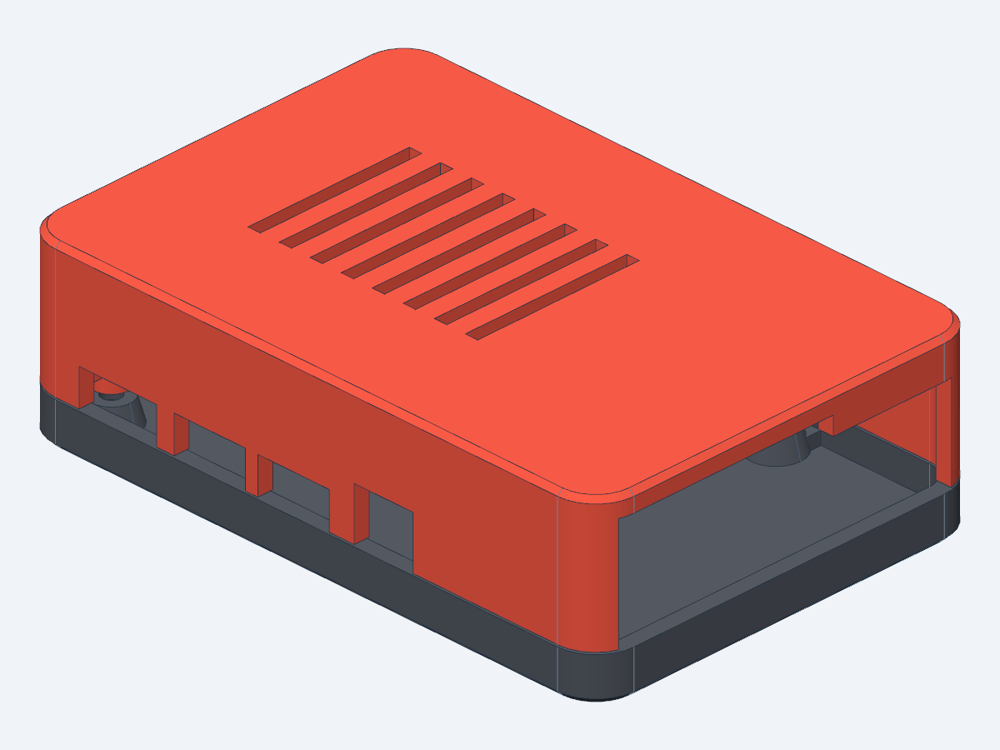

# Housing for the Raspberry Pi SAS host

A two-part, 3D-printable housing for a Raspberry Pi 4 Model B that sits inside the
cabinet and is to take over from the Linux PC as the SAS host (`notes/sas-j10.md`). It holds
the Pi only. The USB RS-232 adapter plugs into one of the Pi's USB ports and is wired to
backplane J10 as that note describes. Power comes in at the USB-C port, and the network
is Wi-Fi or the Ethernet jack. The housing has no mounting features: it stands on its
base.

**Status (2026-11-22):** designed, checked in CAD against a model of the board and
sliced for a Bambu Lab P1S. **Not yet printed or fitted to a real board** (inferred).



## Files

| File | What it is |
|---|---|
| `src/pi4_housing.py` | the parametric model ([build123d](https://github.com/gumyr/build123d), built with the text-to-cad `cad` CLI): `base`, `lid` and the assembled `housing` |
| `stl/base.stl`, `stl/lid.stl` | the two parts as they lie on the build plate, side by side, meshed to 0.02 mm |
| `pi4-housing.3mf` | Bambu Studio project with both parts on one plate: P1S, 0.4 mm nozzle, 0.20 mm Standard, Generic PLA, Textured PEI Plate |
| `print.json` | the presets and the three setting changes that project was written with |
| `pi4-housing.png` | a picture of the assembled model |

## What you need

- A Raspberry Pi 4 Model B.
- Four M2.5 machine screws, 10 to 16 mm long, pan or cap head. They go in from below
  and cut their own thread in the lid's posts (2.1 mm pilot holes, 12 mm deep).
- About 42 g of PLA and 1 h 22 min on a P1S (Bambu Studio 02.09.01.70's estimate).

## Printing

Open `pi4-housing.3mf` in Bambu Studio and print it as it is: no supports, no brim. The
base prints floor down and the lid top face down, so every port opening is an open
notch in a wall's rim. The project differs from the stock process in three settings:

| Setting | Value | Why |
|---|---|---|
| `wall_loops` | 3 | the 2.4 mm walls print as solid walls, with no sparse core |
| `wall_generator` | Arachne | the standoffs and posts print as rings of walls alone |
| `infill_wall_overlap` | 30% | closes the pinholes where solid infill meets the walls on the first layer |

Any PLA works with the Generic PLA preset; pick your filament's own preset if it has one.
PLA softens near 55 to 60 °C: see **In the cabinet**.

## Assembly

1. Set the Pi into the base, microSD end at the square notch. It rests on the four
   standoffs.
2. Put the lid on. Its four posts sit on the board at the mounting holes.
3. Hold the two together, turn them over and drive the four screws through the base.
   Stop when each is snug: the thread is in plastic. If a screw binds, clear the post's
   pilot hole with a 2.1 mm drill.

A seam of about 0.2 to 0.5 mm stays open between base and lid. That is intended: the
screws clamp the board between standoffs and posts, so the walls must not meet first,
and the seam takes up boards from 1.4 to 1.7 mm thick.

The microSD card stays inside the end wall and comes out through the notch below it
with a fingertip, without opening the housing. All four USB ports, Ethernet, USB-C
power, both micro-HDMI ports and the audio jack are open; the side openings are sized
for a plug's overmould (at USB-C, 12.5 mm wide and 5.4 mm high above the board).

## In the cabinet

- Keep the housing and its cables away from the mains wiring and breaker box on the
  left wall, and from J10 pin 31 (+12 V) when routing the serial lead (`notes/sas-j10.md`,
  **The port**).
- Keep it away from the power supply and transformer. The lid has eight slots over the
  processor and seven in the microSD end wall for convection, but PLA creeps once it
  passes about 55 °C, and how warm the closed cabinet gets is not measured.
- Wi-Fi through a closed steel cabinet is untested. If the link is poor, stand the
  housing nearer the door glass or use the Ethernet jack.
- TITO@Home stays unplugged while the Pi is the SAS host (`notes/sas-j10.md`, **Steps**).

## Design

Outer size 93.2 × 62.3 × 27.1 mm; walls 2.4 mm, floor and top 2.0 mm. The board sits
3.6 mm above the floor with 0.75 mm to the side walls and 2.6 mm at the microSD end.
Board dimensions are from Raspberry Pi's mechanical drawing RP-001185-MD-1; every
dimension is a named constant at the top of `src/pi4_housing.py`, and every height is a
multiple of the 0.2 mm layer.

To rebuild after a change, with text-to-cad's `cad` CLI:

```sh
cad run src/pi4_housing.py                  # builds base, lid and housing; prints their ids
cad model dfm <id> --build-volume 256x256x256
cad model export <id> base.glb --tolerance 0.02 && cad glb export base.glb stl/base.stl
```

then write the Bambu Studio project again from the two STLs with the settings in
`print.json`.

## What was checked (2026-11-22)

**Verified** in CAD and in the slicer, not on hardware:

- **Fit.** The housing was assembled round a third-party STEP model of the Pi 4 Model B
  (step.parts, not distributed here) whose connector positions agree with the drawing.
  No part shares volume with the board, as placed and with the board moved 0.3 mm each
  way along both axes; the same check reports the overlap when the board is pushed
  1 mm into a wall.
- **Printability.** Both parts pass text-to-cad's FDM check as models and as the
  exported STLs: no overhang under 45°, no wall under 1 mm, no supports.
- **Slicing.** Bambu Studio 02.09.01.70 reads both STLs as manifold single parts,
  slices the project with every setting read back, and the layer-by-layer check of the
  slice flags no left-out or misplaced plastic.

**Not checked** (inferred):

- a printed part: hole sizes, the screws' bite in the posts and the seam are as designed,
  not as measured;
- the real board against the model: that STEP model has a 1.6 mm board, and plug
  overmoulds vary;
- temperature inside the closed housing in the closed cabinet;
- Wi-Fi reception there.
